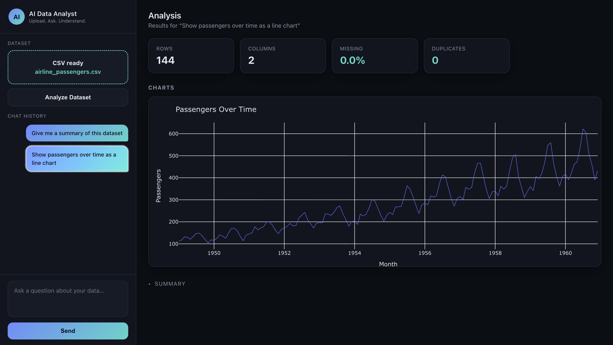
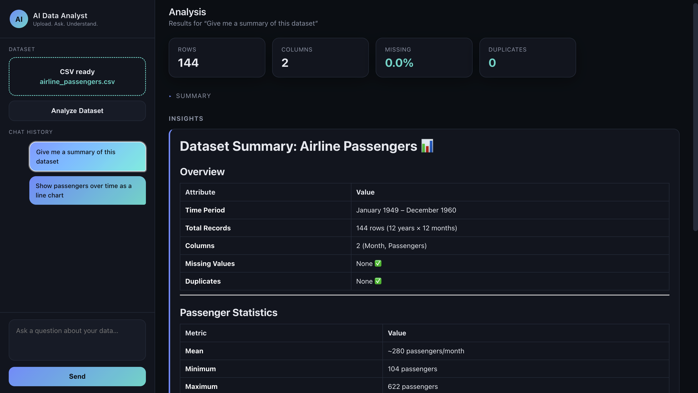
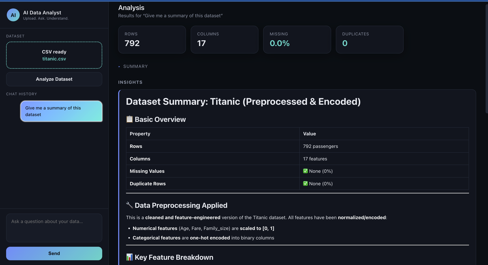
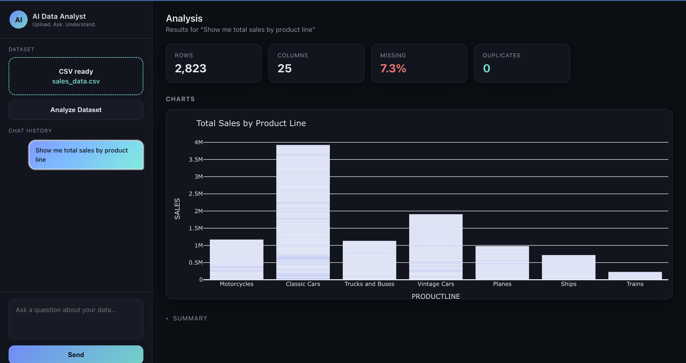
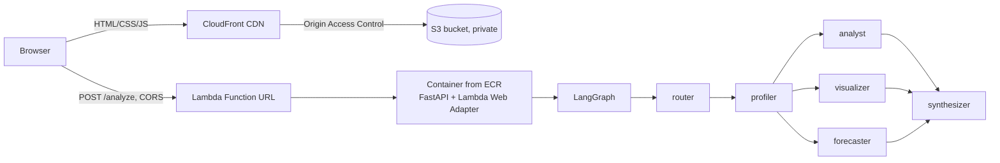

# AI Data Analyst

**Upload a CSV, ask a question in plain English, get statistics, charts and a forecast — answered by a multi-agent LangGraph pipeline.**

[](https://github.com/DanilRodenko/ai-data-analyst/actions/workflows/tests.yml)

**Live demo:** https://d23hu23n8x4tm7.cloudfront.net
*(first request after idle takes ~20 s — AWS Lambda cold start)*



<details>

 ## <summary>More screenshots</summary>






</details>

---

## Problem & Data

Non-technical people have data in spreadsheets but no time to write pandas or build charts. This app lets them upload a CSV and ask questions such as *"Give me a summary"*, *"Show passengers over time as a line chart"* or *"Forecast the next 12 months"*.

Tested on three public datasets with different shapes:

| Dataset | What it exercises |
|---|---|
| Airline passengers (1949–1960) | monthly time series, trend and seasonality, forecasting |
| Titanic | mixed categorical and numeric columns, missing values |
| Sales | transactional data, aggregations for bar and pie charts |

## Architecture



- **router** — LLM classifies the question and picks which agents to run.
- **profiler** — pandas: column types, missing values, duplicates, descriptive statistics.
- **analyst / visualizer / forecaster** — insights, Plotly charts, Prophet forecasts.
- **synthesizer** — writes the final answer from the agents' outputs.

The API is **stateless**: the CSV travels with each request and nothing is stored, so no database or file storage is needed.

## Engineering decisions

| Decision | Why |
|---|---|
| Lambda (container image) instead of EC2 | Pay per request, scales to zero, enough memory for Prophet; no server to patch |
| Frontend on S3 + CloudFront, bucket kept private via OAC | Static files served from a CDN over HTTPS; only CloudFront can read the bucket |
| CORS restricted by `ALLOWED_ORIGINS` env var | Only the CloudFront origin can call the API; changed without rebuilding the image |
| LLM clients created lazily (`get_llm()` + `lru_cache`) | Importing the app needs no API keys, so tests and CI run with zero secrets |
| Upload limit 5 MB → HTTP 413 before any LLM call | Protects Lambda memory and LLM cost; Lambda payload limit is 6 MB |
| API returns only the 4 fields the frontend reads | Response no longer echoes the uploaded dataset back |
| Secrets in Lambda environment variables, LangSmith off in production | Users' data is not sent to a tracing service; for production I'd move keys to Secrets Manager |

## Results / Evaluation

| Metric | Value |
|---|---|
| API response size (airline dataset) | **8 019 → 3 589 bytes (−55%)** after removing the echoed dataset |
| Oversized upload (8 MB) | rejected with **413 in 49 bytes**, no LLM call |
| Automated tests | **3 API tests**, run in CI without any API keys |
| Lambda memory used | **~400 MB** of 2 048 MB |
| Cold start | **~20 s** (imports of LangGraph, pandas, Prophet) |
| Answer quality | *Not measured yet* — see next steps |

### Deployment issues found and fixed

1. **500 on first deploy.** CloudWatch showed a 404 from Groq: the configured model had been retired. Locally the app ran on a different provider, so this path had never been tested. Lesson: production config must match what was tested.
2. **Missing stack traces in CloudWatch.** Lambda freezes the container right after the response, so logs written after the 500 only flushed on the next invocation. Reproduced the production config locally with Docker instead.
3. **HTTP 413 from Groq on forecasts.** The synthesizer prompt was **14 328 tokens**, above the free-tier limit of 8 000 tokens/min. Root cause: the forecaster returned 365 daily points instead of 12 monthly ones, and chart JSON was passed to the LLM. Temporarily switched to Anthropic; fix in progress.

## Known limitations

- Forecaster produces daily points for monthly data (fix in progress).
- Profiler's uniqueness metric is summed across columns and shows values above 100%.
- Cold start of ~20 s on the first request after idle.
- No answer-quality evaluation yet.

## Next steps

- Fix the forecaster and trim the synthesizer prompt, then measure tokens before/after and switch back to the free Groq model.
- Evaluation: fixed set of questions × datasets, compare Groq vs Claude on chart correctness.
- Automated deploy from GitHub Actions (build → ECR → Lambda, S3 sync + CloudFront invalidation).

## Tech stack

- **AI:** LangGraph, LangChain, Groq (`openai/gpt-oss-120b`), Anthropic Claude Sonnet
- **Data:** pandas, NumPy, Prophet, Plotly
- **Backend:** FastAPI, Uvicorn, Docker
- **Frontend:** HTML, CSS, vanilla JavaScript
- **Cloud:** AWS Lambda (arm64, Lambda Web Adapter), ECR, S3, CloudFront, CloudWatch
- **CI:** GitHub Actions, pytest

## Run locally

```bash
git clone https://github.com/DanilRodenko/ai-data-analyst.git
cd ai-data-analyst
python3.11 -m venv .venv && source .venv/bin/activate
pip install -r requirements-dev.txt
cp .env.example .env          # add your API keys

# backend
python -m uvicorn app.main:app --reload            # http://localhost:8000/docs

# frontend (second terminal)
cd frontend && python -m http.server 5500          # http://localhost:5500

# tests
python -m pytest -v
```

Or with Docker:

```bash
docker build -t ai-data-analyst .
docker run --rm -p 8080:8080 --env-file .env ai-data-analyst
```